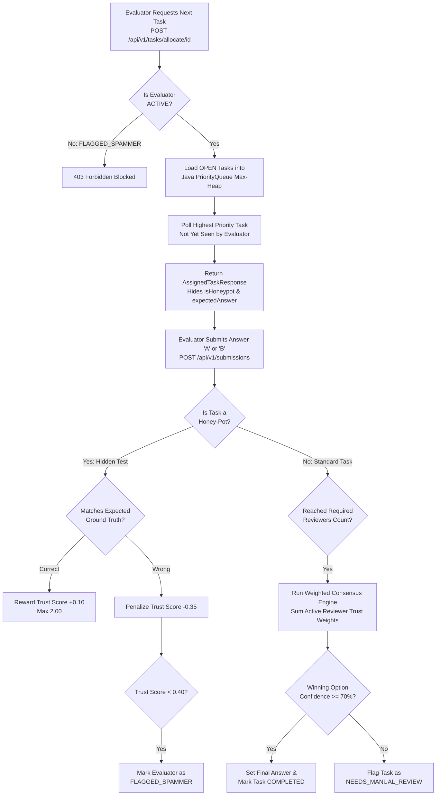

# 🛡️ TrustEval — Anti-Spam Task Allocation & Evaluator Trust Engine


**TrustEval** is a Spring Boot backend engine designed for crowd-sourced AI/RLHF evaluation platforms. It solves three real-world problems in human-in-the-loop data labeling: **urgent task routing**, **spammer detection via hidden Honey-Pot tasks**, and **trust-weighted answer consensus**.

---

## 🎯 Problem Statement & How TrustEval Solves It

| Challenge in AI Evaluation Platforms | How TrustEval Solves It |
| :--- | :--- |
| **1. Duplicate & Unordered Tasks:** Reviewers accidentally receive the same prompt twice, while urgent prompts sit waiting in the queue. | Uses a **Java `PriorityQueue` (Max-Heap)** ordered by `priority DESC, createdAt ASC` paired with a composite database unique constraint `(evaluator_id, task_id)` so urgent tasks are always routed first and **no user ever receives the same task twice**. |
| **2. Spammers Clicking Random Answers:** Reviewers rapidly click `Option A` or `Option B` without reading to earn payouts. | Injects hidden **Honey-Pot tasks** (questions with known ground-truth answers) without exposing `isHoneypot` in the API response. Wrong answers slash the user's `trustScore` by `-0.35` and auto-flag accounts below `0.40` as `FLAGGED_SPAMMER`. |
| **3. Naive Majority Vote Fails:** If 2 low-trust users vote `B` and 1 highly trusted expert votes `A`, simple majority picks the wrong answer. | Implements a **Weighted Consensus Engine** where each reviewer's vote carries their dynamic `trustScore` weight. Tasks with `< 70%` weighted confidence are automatically flagged as `NEEDS_MANUAL_REVIEW`. |

---

## 🏗️ System Architecture & Workflow



---

## 🧠 Core DSA & Backend Concepts Used

### 1. Max-Heap Task Routing (`PriorityQueue<EvaluationTask>`)
Located in `TaskAllocationService.java`:
```java
Comparator<EvaluationTask> maxHeapComparator = Comparator
        .comparingInt(EvaluationTask::getPriority).reversed()
        .thenComparing(EvaluationTask::getCreatedAt);

PriorityQueue<EvaluationTask> maxHeap = new PriorityQueue<>(maxHeapComparator);
maxHeap.addAll(openTasks);
```
* **Time Complexity:** $O(N \log N)$ heap construction, $O(\log N)$ per poll to skip tasks already assigned to that reviewer.
* **No-Duplicate Guarantee:** Enforced at both the service check (`existsByEvaluatorIdAndTaskId`) and the database level via `@UniqueConstraint(columnNames = {"evaluator_id", "task_id"})`.

### 2. Honey-Pot Trust Score Formula
Located in `TrustScoreService.java`:
* **Default Trust Score:** `1.00` (Range: `0.00` to `2.00`)
* **Passing a Honey-Pot:** $\text{Trust}_{new} = \min(2.00, \text{Trust}_{old} + 0.10)$
* **Failing a Honey-Pot:** $\text{Trust}_{new} = \max(0.00, \text{Trust}_{old} - 0.35)$
* **Auto-Ban Threshold:** If $\text{Trust}_{new} < 0.40$, status transitions to `FLAGGED_SPAMMER` and all future task allocations/submissions are blocked.

### 3. Weighted Consensus Formula
Located in `ConsensusService.java`:
$$\text{Confidence}(X) = \frac{\sum_{i \in \text{Voters}(X)} \text{TrustScore}_i}{\sum_{i \in \text{AllActiveVoters}} \text{TrustScore}_i}$$

* **Example:** If Reviewer 1 (`trustScore = 1.80`) votes **Option A**, and Reviewer 2 (`trustScore = 0.45`) votes **Option B**:
  * Total Weight = $1.80 + 0.45 = 2.25$
  * Option A Confidence = $\frac{1.80}{2.25} = 0.80$ (**80%** $\ge 70\%$ threshold) $\rightarrow$ Task resolves to **`A` (`COMPLETED`)**.
* If confidence is `< 0.70` (e.g., 55% vs 45% split), the task is flagged as **`NEEDS_MANUAL_REVIEW`**.

---

## 📡 REST API Endpoints

| Method | Endpoint | Description |
| :--- | :--- | :--- |
| `POST` | `/api/v1/evaluators` | Register a new evaluator (starts with `trustScore = 1.0`) |
| `GET` | `/api/v1/evaluators` | List all evaluators with their current trust scores & status |
| `GET` | `/api/v1/evaluators/{id}` | Fetch single evaluator profile & honey-pot accuracy stats |
| `POST` | `/api/v1/tasks` | Create a new evaluation task (normal or hidden `isHoneypot: true`) |
| `GET` | `/api/v1/tasks` | List all tasks (optional query param `?status=OPEN`) |
| `POST` | `/api/v1/tasks/allocate/{evaluatorId}` | Pop highest-priority unseen task from Max-Heap for this evaluator |
| `POST` | `/api/v1/submissions` | Submit answer (`A` or `B`), trigger honey-pot check & weighted consensus |

---

## 🚀 How to Run Locally in 2 Minutes

The project is pre-configured with an **H2 In-Memory Database** and an automatic **`DataSeeder`** (which pre-loads 3 sample evaluators, 2 normal tasks, and 1 high-priority Honey-Pot task on startup), so it runs out-of-the-box with **zero setup**!

### Prerequisites
* **Java 17+** and **Maven** (or run directly from **IntelliJ IDEA**).

### Steps
```bash
# 1. Clone the repository
git clone https://github.com/anmolchandel13/TrustEval.git
cd TrustEval

# 2. Run automated JUnit 5 tests (verifies Max-Heap, Honey-Pot penalty & Weighted Consensus)
mvn test

# 3. Start the Spring Boot server
mvn spring-boot:run
```

### Interactive Swagger UI & H2 Database Console
* **Swagger UI (Test APIs in Browser):** [http://localhost:8080/swagger-ui.html](http://localhost:8080/swagger-ui.html)
* **H2 Database Console:** [http://localhost:8080/h2-console](http://localhost:8080/h2-console) (`JDBC URL: jdbc:h2:mem:trustevaldb`)

---

## 🧪 Quick cURL Test Walkthrough

```bash
# Step 1: Allocate the highest-priority task to Evaluator #2 (Rohan, trustScore = 1.0)
# (The Max-Heap will automatically pop Task #1 which has Priority 95 - a hidden Honey-Pot!)
curl -X POST http://localhost:8080/api/v1/tasks/allocate/2

# Step 2: Submit a WRONG answer ("B") on Task #1 to see Honey-Pot spam detection in action
curl -X POST http://localhost:8080/api/v1/submissions \
  -H "Content-Type: application/json" \
  -d '{"evaluatorId": 2, "taskId": 1, "selectedAnswer": "B"}'
```

---

## 👤 Author

**Anmol Chandel**  
B.Tech in Electronics & Communication Engineering — Institute of Engineering and Technology (IET), Lucknow  
📧 [anmolchandel13@gmail.com](mailto:anmolchandel13@gmail.com) | 🔗 [GitHub](https://github.com/anmolchandel13)
